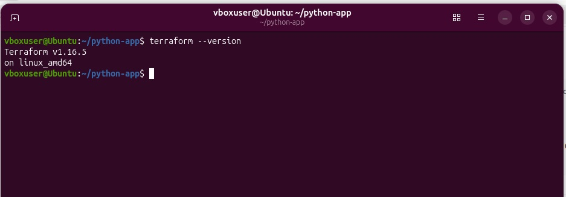
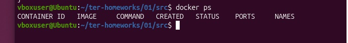
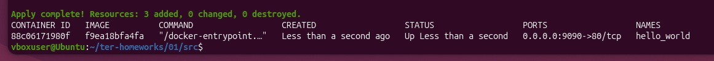
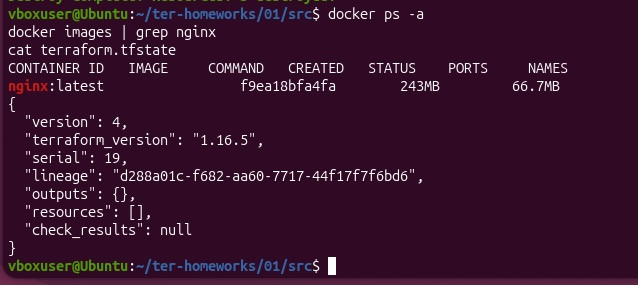
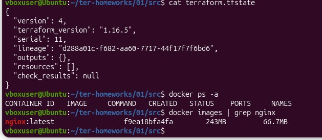
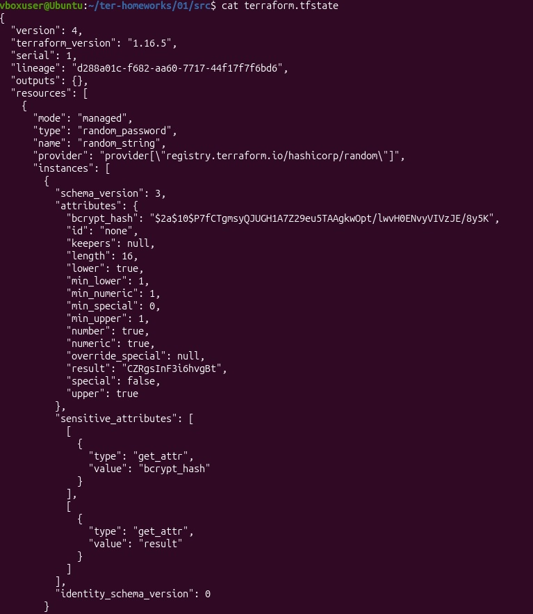
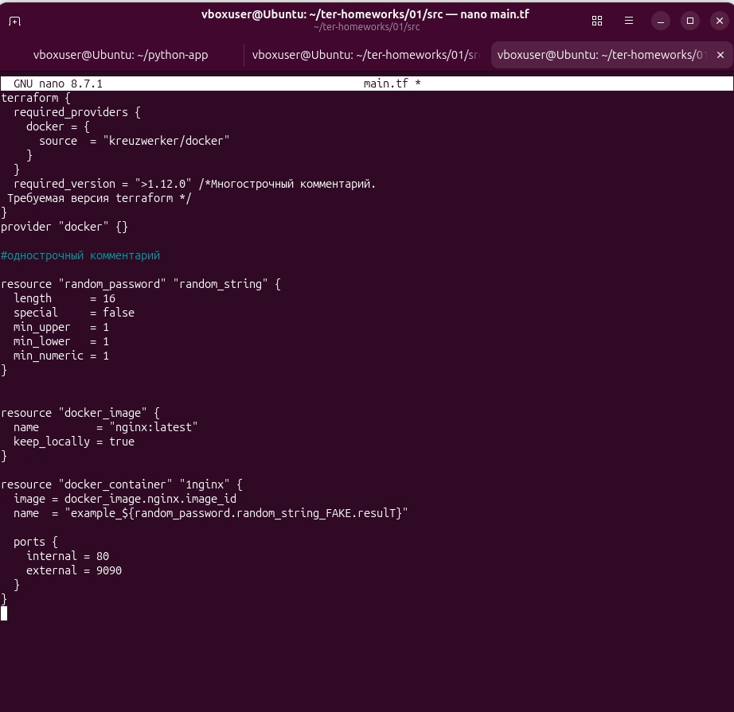

# Домашнее задание «Введение в Terraform»
Цели задания
Установить и настроить Terrafrom.
Научиться использовать готовый код.
Чек-лист готовности к домашнему заданию
Скачайте и установите Terraform версии >=1.12.0 . Приложите скриншот вывода команды terraform --version.
Скачайте на свой ПК этот git-репозиторий. Исходный код для выполнения задания расположен в директории 01/src.
Убедитесь, что в вашей ОС установлен docker.
Инструменты и дополнительные материалы, которые пригодятся для выполнения задания
Репозиторий с ссылкой на зеркало для установки и настройки Terraform: ссылка.
Установка docker: ссылка.
Внимание!! Обязательно предоставляем на проверку получившийся код в виде ссылки на ваш github-репозиторий!
Задание 1
Перейдите в каталог src. Скачайте все необходимые зависимости, использованные в проекте.
Изучите файл .gitignore. В каком terraform-файле, согласно этому .gitignore, допустимо сохранить личную, секретную информацию?(логины,пароли,ключи,токены итд)
Выполните код проекта. Найдите в state-файле секретное содержимое созданного ресурса random_password, пришлите в качестве ответа конкретный ключ и его значение.
Раскомментируйте блок кода, примерно расположенный на строчках 29–42 файла main.tf. Выполните команду terraform validate. Объясните, в чём заключаются намеренно допущенные ошибки. Исправьте их.
Выполните код. В качестве ответа приложите: исправленный фрагмент кода и вывод команды docker ps.
Замените имя docker-контейнера в блоке кода на hello_world. Не перепутайте имя контейнера и имя образа. Мы всё ещё продолжаем использовать name = "nginx:latest". Выполните команду terraform apply -auto-approve. Объясните своими словами, в чём может быть опасность применения ключа -auto-approve. Догадайтесь или нагуглите зачем может пригодиться данный ключ? В качестве ответа дополнительно приложите вывод команды docker ps.
Уничтожьте созданные ресурсы с помощью terraform. Убедитесь, что все ресурсы удалены. Приложите содержимое файла terraform.tfstate.
Объясните, почему при этом не был удалён docker-образ nginx:latest. Ответ ОБЯЗАТЕЛЬНО НАЙДИТЕ В ПРЕДОСТАВЛЕННОМ КОДЕ, а затем ОБЯЗАТЕЛЬНО ПОДКРЕПИТЕ строчкой из документации terraform провайдера docker. (ищите в классификаторе resource docker_image )
## Ответы

### 1. terraform --version

Terraform v1.16.5 (>= 1.12.0).

### 2. Секрет в state-файле

В terraform.tfstate секретное содержимое ресурса random_password хранится в атрибуте result.
- Ключ: result
- Значение: CZRgsInF3i6hvgBt

### 3. Ошибки terraform validate

1. У docker_image не было имени — исправлено на resource "docker_image" "nginx".
2. Имя 1nginx начинается с цифры — переименовано в nginx.
3. Ссылка на несуществующий ресурс — исправлено на random_password.random_string.result.

### 4. terraform destroy

После destroy state-файл:
{
  "version": 4,
  "terraform_version": "1.16.5",
  "serial": 11,
  "lineage": "d288a01c-f682-aa60-7717-44f17f7f6bd6",
  "outputs": {},
  "resources": [],
  "check_results": null
}

### 5. docker ps с hello_world

resource "docker_image" "nginx" {
  name         = "nginx:latest"
  keep_locally = true
}

resource "docker_container" "nginx" {
  image = docker_image.nginx.image_id
  name  = "hello_world"
  ports {
    internal = 80
    external = 9090
  }
}

### 6. Про -auto-approve

Ключ -auto-approve пропускает подтверждение yes. Опасность: изменения применяются без проверки человеком. Полезен в CI/CD и скриптах.

### 7. Почему образ nginx:latest не был удалён

В коде установлен keep_locally = true.

Документация провайдера docker, ресурс docker_image:
keep_locally (Boolean) If true, then the Docker image won't be deleted on destroy operation.
EOF
